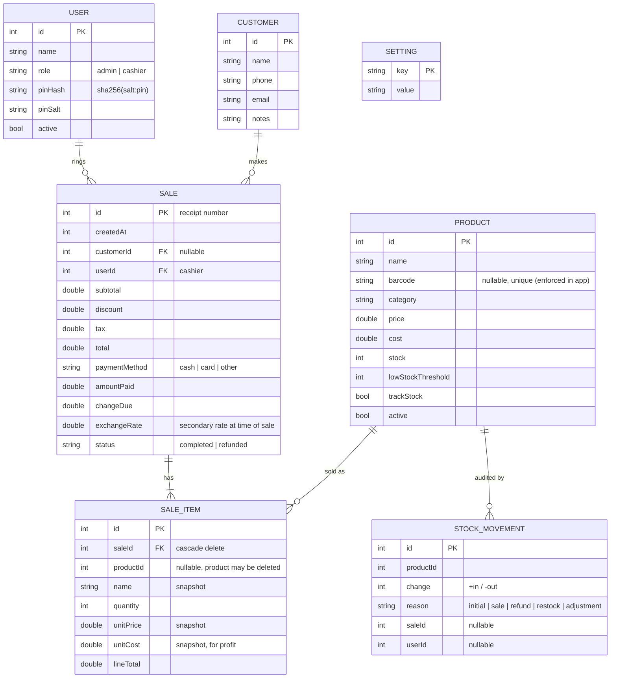

# Data Model (POS)

SQLite via Floor, schema version 4 (`lib/database/database.dart`). Amounts are
stored in the primary currency; timestamps are epoch milliseconds.

## Invariants

- Stock only changes through `ProductDao.adjustStock`, `SaleDao.recordSale` and
  `SaleDao.refundSale`; each runs in one transaction and writes a
  `STOCK_MOVEMENT` row.
- Sale lines snapshot name, price and cost, so receipts and profit reports stay
  correct after a product is edited or deleted.
- Reports count only `status = completed` sales; refunds are reported separately.

## Upgrading from the original app (v1–v2)

`migrateLegacySchema` (`lib/database/migrations.dart`) copies `items` into
`products` (stock not tracked) and the `rate` row into the secondary-currency
settings (`L.L`). The old tables are kept, renamed to `legacy_items` /
`legacy_rate`. Covered by `test/database_test.dart`.
